# Robust Adaptive Thresholding for LSTM Autoencoder-Based Anomaly Detection in Streaming Time Series

**Zain Hassan · MS Data Science · FAST-NUCES Islamabad · Reg. 26I-8015**

## Overview

An **LSTM Autoencoder** learns what normal behaviour looks like in a time series and tries to rebuild each short window of it. When it rebuilds a window badly (high *reconstruction error*), that moment may be an anomaly. The model only produces a score, though. A **threshold rule** has to decide which scores become alarms, and that decision is what this project studies.

The project compares a **moving median + λ·MAD threshold** (the proposed method, P1) with fixed thresholds (B1, B2) and with the base paper's mean + 3σ rule (B3, B4). The comparison is controlled: every rule sees the same data, the same model and the same reconstruction errors, so **only the threshold rule changes**. The benchmark is the complete **Numenta Anomaly Benchmark (NAB)**: 58 real and artificial time series with 116 labelled anomaly windows.

Every figure on this page is generated by the pipeline's code from the experiment outputs. None are drawn by hand.

| | |
|---|---|
| 📊 Interactive dashboard | [`dashboard/index.html`](dashboard/index.html). Download it and open it in a browser. |
| 📄 Protocol, fixed before training | [`PROTOCOL.md`](PROTOCOL.md) |
| 📐 Every metric formula | [`docs/METHODOLOGY.md`](docs/METHODOLOGY.md) |
| 📈 Every number and statistical test | [`docs/RESULTS.md`](docs/RESULTS.md) |
| 🔧 What changed from earlier versions, and why | [`docs/CHANGES.md`](docs/CHANGES.md) |

## Main findings

On the full corpus (52 files with 107 anomaly windows, plus 6 anomaly-free files):

1. **The proposed threshold does not beat the baselines.** P1's composite F1 is 0.433, against 0.473 for B1 and 0.468 for B2. Its NAB score is 30.3, against 39.0 and 43.5. H1 and H3 are not supported.
2. **It finds more anomalies but raises more false alarms.** P1's event recall is 0.815, against 0.717 and 0.692. Its false-alarm rate in high-variability periods is 0.255, against 0.172 and 0.134 (significantly higher than B2, p = 0.008). So H2 does not hold on average.
3. **The model's score is the bottleneck.** The LSTM-AE separates anomalies only weakly (median ROC-AUC 0.61). No threshold rule can make up for a weak score, so the differences between rules are small and mostly not statistically significant.
4. **Why median/MAD struggles.** On 4 of 52 files the MAD of training errors collapses to zero. On the rest, the σ-based spread is a median 2.2× larger, so one λ does not transfer well from file to file.
5. **The rolling window helps; the median/MAD statistic does not.** The best rule overall is a rolling mean + k·σ (ablation A3: composite F1 0.514, NAB 47.1).
6. **Domains (RQ4).** P1 does best on AWS CloudWatch and Traffic, and worst on Twitter and the artificial series.

The 60/20/20 split from the proposal (18 files, 25 windows) gives the same overall conclusion. There, P1 had fewer false alarms but missed more anomalies.

---

## 1. How the experiment works


The data is downloaded, cleaned and split. One LSTM-AE is trained per file, window size and seed, and its reconstruction errors are saved once. Every threshold rule is then applied to those identical errors. Rule parameters are chosen **without test labels**: leave-one-file-out on the full corpus, and on the validation part for the 60/20/20 split.

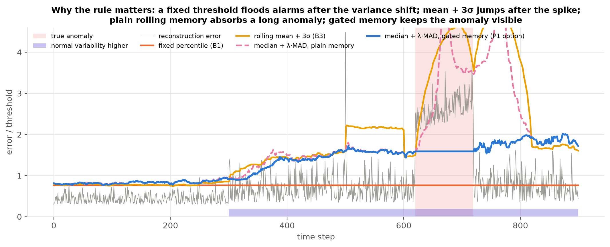

*A synthetic illustration (not evidence) of how each rule behaves. A fixed threshold floods alarms after normal variability increases. Mean + 3σ jumps after one spike. A plain rolling median absorbs a long anomaly. Gated memory keeps the anomaly out of its window. P1 chooses plain or gated memory on validation data.*

## 2. Data

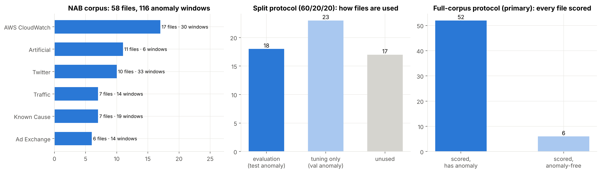

*All 58 NAB files across six domains. The full-corpus protocol scores every file. The proposal's 60/20/20 split can evaluate only the 18 files that have an anomaly in their last 20 %.*

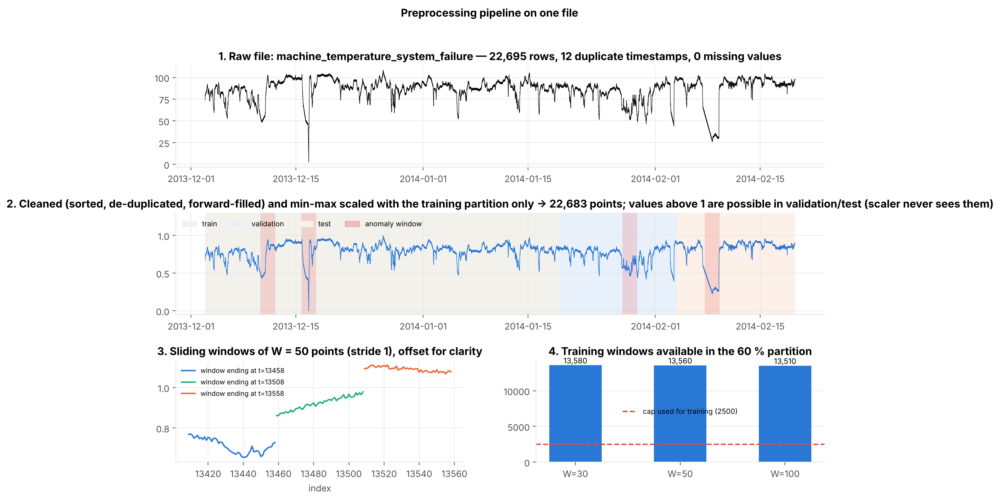

*Preprocessing on one file: the raw series, then cleaning (sorting, removing duplicate timestamps, filling gaps) and scaling with training data only, then sliding windows, then the training windows available.*


*Normal variability is not constant: local volatility drifts by an order of magnitude. This is the motivation for adaptive thresholds.*

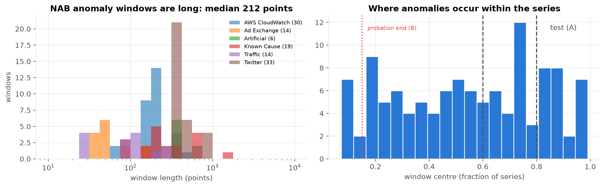

*NAB anomaly windows are long (median length shown in the title) and spread throughout the series.*

More: [split overview](figures/eda/split_overview.png) · [autocorrelation by domain](figures/eda/autocorrelation_by_domain.png) · [domains and sizes](figures/eda/domains_and_sizes.png) · one EDA figure per file in [`figures/eda/series/`](figures/eda/series/).

## 3. Model training

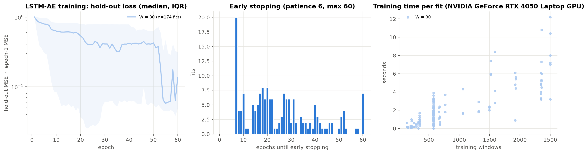

*174 LSTM-AE fits on an RTX 4050. Left: the hold-out loss falls and early stopping restores the best epoch. Middle: most fits stop well before the 60-epoch limit. Right: training time per fit.*

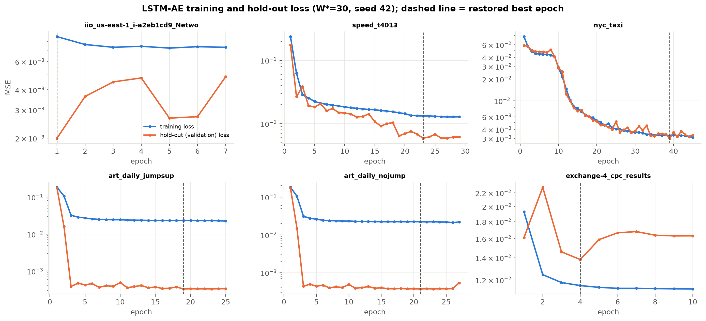

*Training and hold-out loss for example files. The dashed line marks the restored best epoch.*

## 4. Results

<!-- RESULTS_START -->
**Full-corpus protocol (primary)** — 52 files, 107 anomaly windows, W* = 30

| Method | Composite F1 ↑ | Point F1 ↑ | Precision ↑ | Recall ↑ | Event recall ↑ | FPR ↓ | High-var FPR ↓ | Alerts ↓ | NAB std ↑ | NAB low-FP ↑ | NAB low-FN ↑ | Delay ↓ |
|---|---:|---:|---:|---:|---:|---:|---:|---:|---:|---:|---:|---:|
| B1 Fixed percentile | 0.473 | 0.226 | 0.398 | 0.231 | 0.717 | 0.078 | 0.172 | 11.6 | 39.0 | 13.1 | 48.9 | 0.397 |
| B2 Fixed mean + k·σ | 0.468 | 0.222 | 0.398 | 0.217 | 0.692 | 0.069 | 0.134 | 11.0 | 43.5 | 22.3 | 52.1 | 0.429 |
| B3 Rolling mean + 3σ (base paper) | 0.482 | 0.207 | 0.393 | 0.151 | 0.827 | 0.031 | 0.141 | 17.9 | 36.6 | -4.370 | 51.7 | 0.367 |
| B4 Global mean + 3σ (base paper, untuned) | 0.458 | 0.237 | 0.366 | 0.246 | 0.783 | 0.087 | 0.200 | 17.3 | 32.7 | -4.814 | 46.6 | 0.383 |
| **P1 Moving median + λ·MAD (proposed)** | 0.433 | 0.221 | 0.376 | 0.219 | 0.815 | 0.098 | 0.255 | 17.3 | 30.3 | -12.7 | 46.2 | 0.354 |

H1: Not supported · H2: Partially supported · H3: Not supported

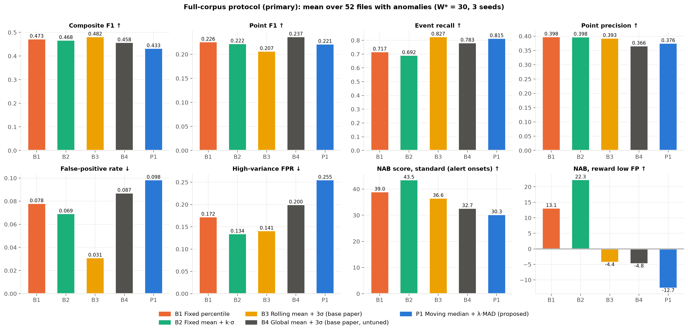

**Split protocol (proposal, 60/20/20)** — 18 files, 25 anomaly windows, W* = 30

| Method | Composite F1 ↑ | Point F1 ↑ | Precision ↑ | Recall ↑ | Event recall ↑ | FPR ↓ | High-var FPR ↓ | Alerts ↓ | NAB std ↑ | NAB low-FP ↑ | NAB low-FN ↑ | Delay ↓ |
|---|---:|---:|---:|---:|---:|---:|---:|---:|---:|---:|---:|---:|
| B1 Fixed percentile | 0.707 | 0.370 | 0.613 | 0.370 | 0.972 | 0.196 | 0.238 | 9.056 | 64.0 | 44.4 | 72.0 | 0.366 |
| B2 Fixed mean + k·σ | 0.699 | 0.393 | 0.597 | 0.397 | 0.972 | 0.207 | 0.272 | 9.907 | 60.7 | 37.3 | 69.8 | 0.328 |
| B3 Rolling mean + 3σ (base paper) | 0.741 | 0.255 | 0.714 | 0.169 | 0.910 | 0.024 | 0.090 | 4.741 | 66.6 | 55.9 | 72.0 | 0.396 |
| B4 Global mean + 3σ (base paper, untuned) | 0.743 | 0.373 | 0.657 | 0.373 | 0.972 | 0.194 | 0.245 | 5.611 | 73.3 | 64.1 | 78.2 | 0.380 |
| **P1 Moving median + λ·MAD (proposed)** | 0.547 | 0.179 | 0.489 | 0.138 | 0.793 | 0.037 | 0.090 | 5.759 | 54.7 | 39.7 | 61.8 | 0.399 |

H1: Not supported · H2: Supported descriptively (not significant) · H3: Not supported

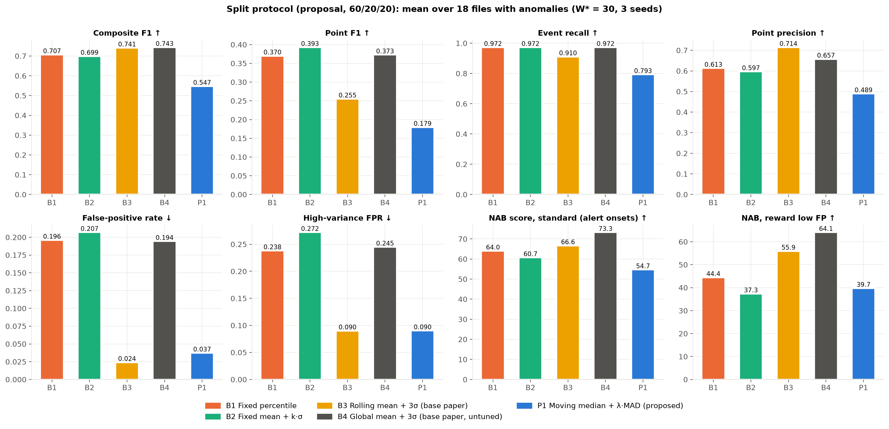

Full tables, statistics and every figure: [docs/RESULTS.md](docs/RESULTS.md)
<!-- RESULTS_END -->

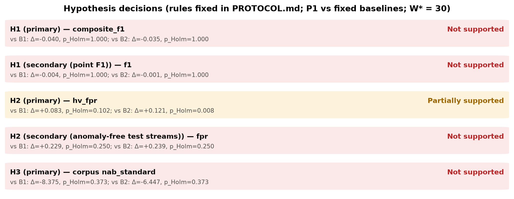

*Hypothesis decisions under the rules fixed in `PROTOCOL.md`, with the size of each difference and its Holm-corrected p-value.*


*The main metrics for the five main rules, as means over the 52 files with anomalies.*

### Where the alarms go

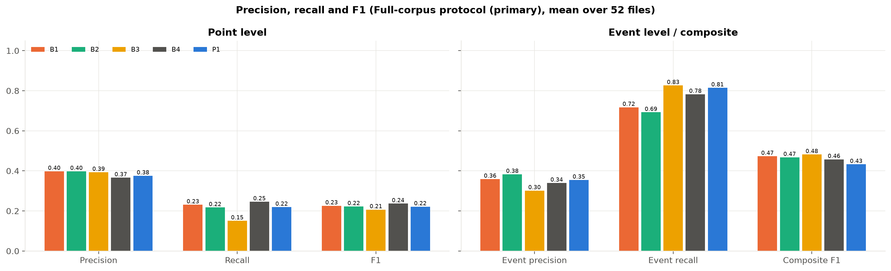

*Point-level and event-level precision, recall and F1. Event recall counts each anomaly window once, and the composite F1 combines event recall with point precision.*

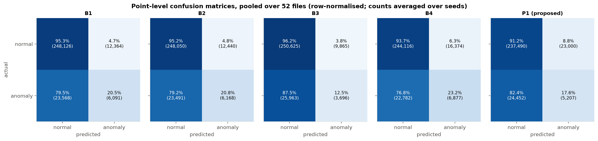

*Point-level confusion matrices pooled over all files, normalised by row.*

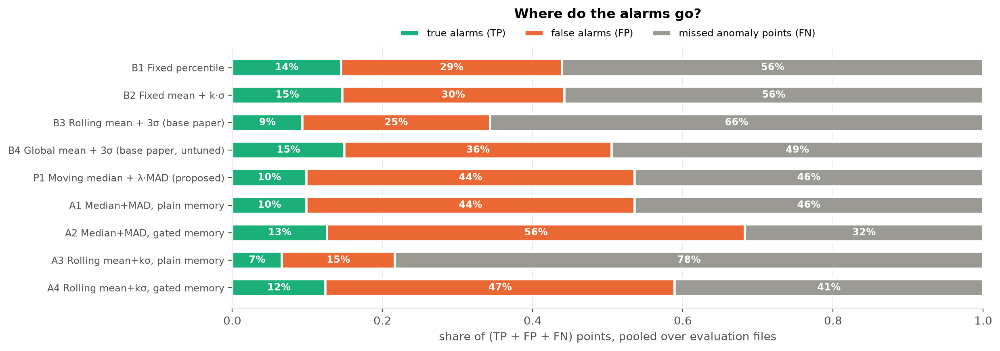

*Shares of true alarms, false alarms and missed anomaly points for every rule.*

## 5. Why the results look like this

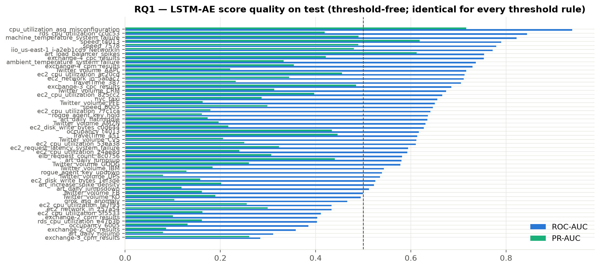

*ROC-AUC and PR-AUC of the LSTM-AE score per file. They are the same for every threshold rule. Many files sit close to 0.5 (chance), which limits what any threshold can achieve.*

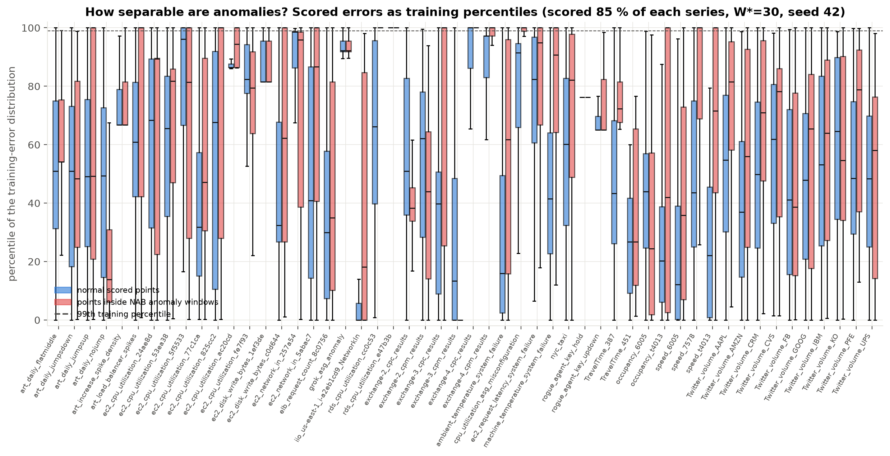

*Scored errors expressed as percentiles of each file's training errors. Normal points (blue) and anomaly points (red) overlap heavily on most files.*

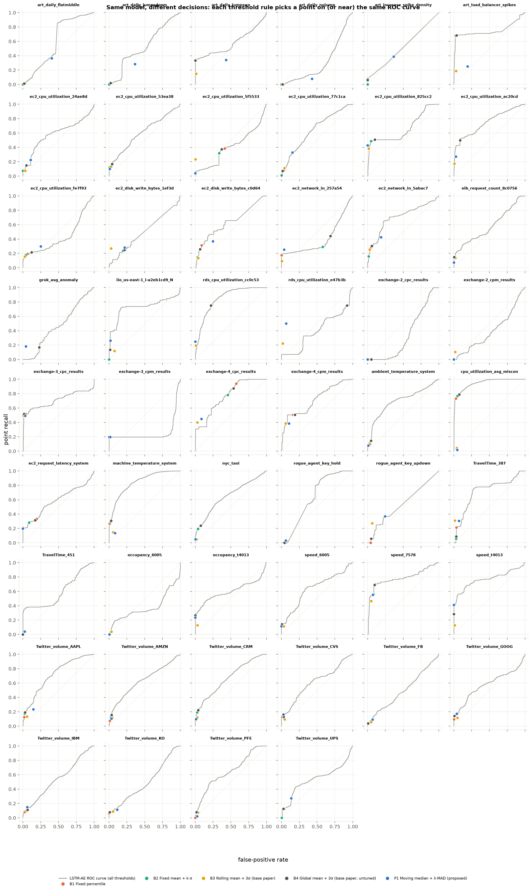

*Each rule is simply a different operating point on the same model's ROC curve.*

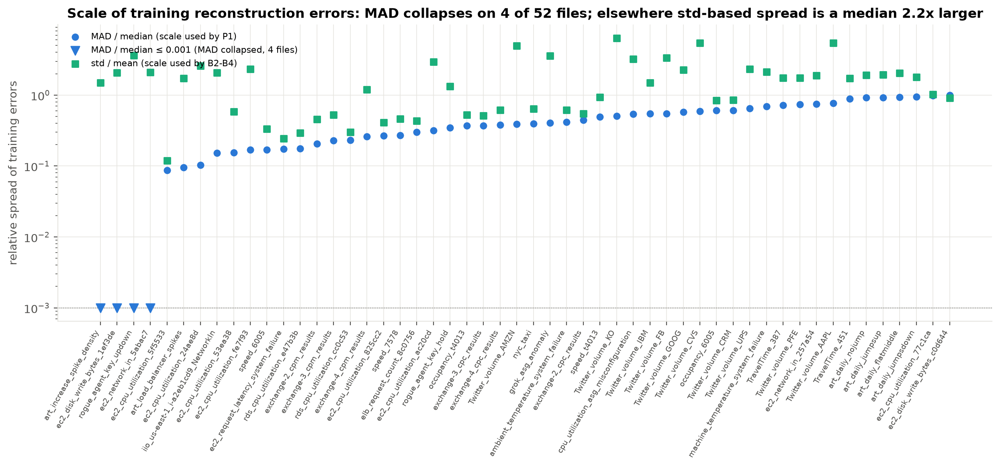

*Scale of the training reconstruction errors. MAD (P1's scale) collapses to zero on 4 files. Elsewhere it is much smaller than σ, so a single λ does not transfer between files.*

## 6. Thresholds over time on real data

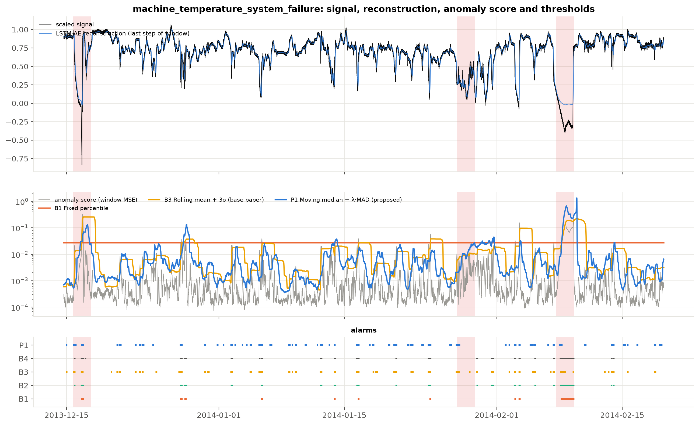

*One file in detail. Top: the signal and the LSTM-AE reconstruction. Middle: the anomaly score with three threshold rules. Bottom: where each rule raises alarms. Red bands are labelled NAB anomaly windows.*

The same plot exists for every file in [`figures/full/traces/`](figures/full/traces/).

## 7. Ablation and sensitivity

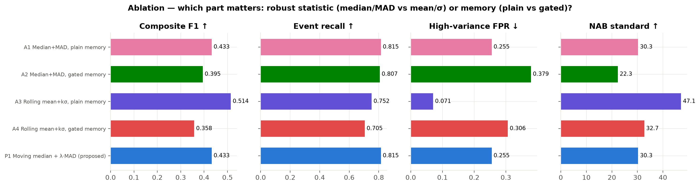

*Which part matters: the statistic (median/MAD vs mean/σ) or the memory (plain vs gated)? The rolling mean/σ with plain memory (A3) does best, and gated memory does not help.*

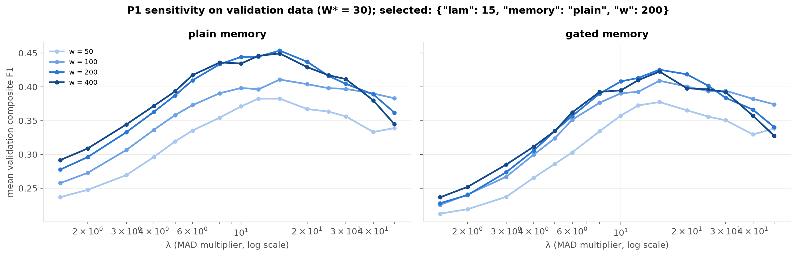

*P1's composite F1 as λ, the window length and the memory type vary.*

## 8. Results by domain (RQ4)

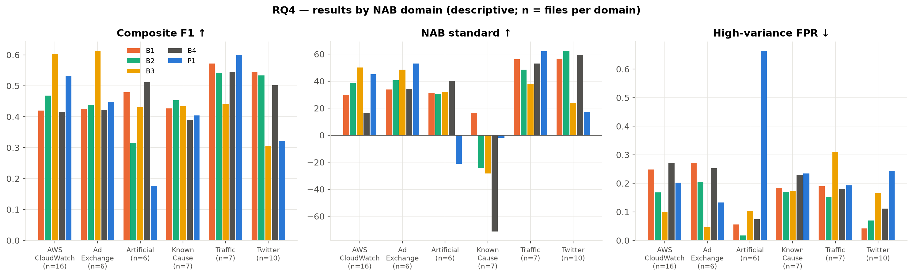

*Composite F1, NAB score and high-variance false-alarm rate per NAB domain (descriptive, with 6–16 files per domain).*

## 9. False alarms and per-file detail

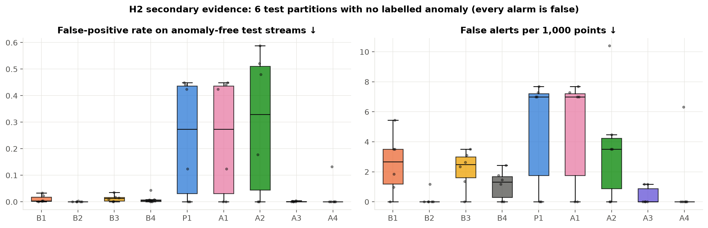

*False alarms on the 6 anomaly-free files, where every alarm is false. P1 over-alarms on smooth artificial series.*

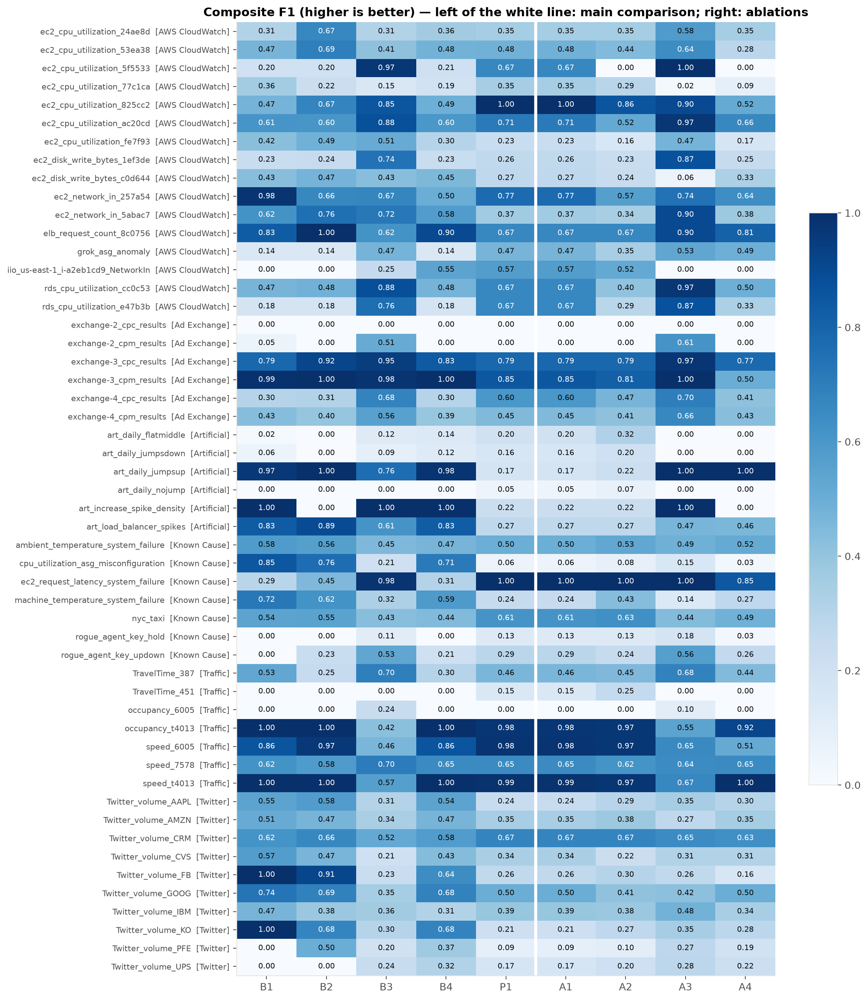

*Composite F1 for every file and rule (ablations to the right of the white line).*


*P1 against each baseline, one point per file.*

More: [NAB score heatmap](figures/full/heatmap_nab_standard.png) · [high-variance FPR heatmap](figures/full/heatmap_hv_fpr.png) · [average rank](figures/full/average_rank.png) · [radar profile](figures/full/radar_profile.png) · [detection delay and alerts](figures/full/delay_and_alerts.png) · the same figures for the 60/20/20 split in [`figures/split/`](figures/split/) · vector PDFs for the paper in [`figures/full/pdf/`](figures/full/pdf/).

---

## Methods compared

| ID | Threshold rule | Role |
|---|---|---|
| B1 | fixed p-th percentile of training errors | fixed baseline (proposal) |
| B2 | fixed mean + k·σ of training errors | fixed baseline (proposal) |
| B3 | rolling mean + 3σ of the last w errors | base paper |
| B4 | global mean + 3σ of training errors | base paper, untuned |
| **P1** | **moving median + λ·MAD of the last w errors** | **proposed** |
| A1–A4 | {median/MAD, mean/σ} × {plain, gated memory} | ablation |

## Metrics

Point precision / recall / F1 / FPR and confusion matrices · event recall and precision · **composite F1** (Garg et al., 2021) · high-variance FPR and anomaly-free-stream FPR (H2) · detection delay · ROC-AUC and PR-AUC of the score (model quality) · **NAB score** computed with Numenta's scoring function (verified against the official code), normalised 0 = never alarming, 100 = perfect. Alarms are reported to the NAB scorer as alert onsets. This is not a NAB leaderboard score; see [`docs/METHODOLOGY.md`](docs/METHODOLOGY.md).

## Run it (Ubuntu / WSL with an NVIDIA GPU)

```bash
bash setup_wsl.sh                 # once: Python environment + PyTorch (CUDA) + checks + tests
source .venv/bin/activate
python run_pipeline.py            # download -> EDA -> runtime check -> train -> evaluate -> figures -> dashboard -> report
```

Step-by-step guide: [`docs/RUN_ON_WSL.md`](docs/RUN_ON_WSL.md). Every figure and number is written by the pipeline from the experiment outputs.

## Repository map

| Path | Content |
|---|---|
| `PROTOCOL.md` | design and decision rules, fixed before training |
| `docs/` | methodology (metric formulas), changes, run guide, generated results report |
| `configs/` | experiment configuration and dataset selection |
| `src/atd/` | data, LSTM-AE, threshold rules, NAB scorer, metrics, statistics, plot style |
| `scripts/` | pipeline steps (see `run_pipeline.py --help`) |
| `results/` | all tables and JSON outputs (`full/`, `split/`) |
| `figures/` | `eda/`, `method/`, `full/`, `split/` (PNG; `pdf/` for the paper) |
| `dashboard/` | interactive dashboards (`index.html` = full corpus, `split.html`) |
| `tests/` | unit tests (`python tests/test_core.py`) |
| `paper/` | IEEE template for the paper |

Data: Numenta Anomaly Benchmark (Lavin & Ahmad, 2015), included under `data/nab/` with its labels and license.
