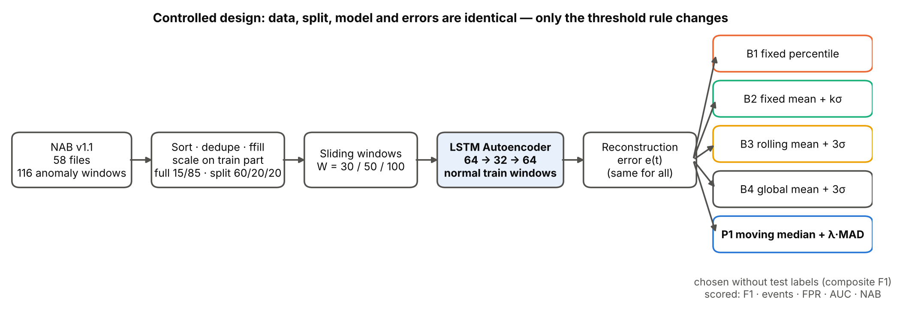

# Robust Adaptive Thresholding for LSTM Autoencoder-Based Anomaly Detection in Streaming Time Series

**Zain Hassan · MS Data Science · FAST-NUCES Islamabad · Reg. 26I-8015**

An LSTM Autoencoder turns each NAB time series into a stream of reconstruction errors. A *threshold rule* then decides which errors are anomalies. This project tests whether a **moving Median + λ·MAD threshold** (proposed) improves on fixed thresholds and on the base paper's mean + 3σ rule, in a controlled experiment where the data, split, model and errors are identical and **only the threshold rule changes**.

> 📊 **Interactive dashboard:** open [`dashboard/index.html`](dashboard/index.html) in a browser (internet needed for the Plotly library).
> 📄 **Protocol fixed before training:** [`PROTOCOL.md`](PROTOCOL.md) · **Results write-up:** [`docs/RESULTS.md`](docs/RESULTS.md)



## The idea in one picture


- A **fixed** threshold (orange-red) fires constantly once normal variability increases.
- **Rolling mean + 3σ** (base paper) jumps after one isolated spike.
- **Median + λ·MAD with plain memory** absorbs a long anomaly into its own window.
- **Gated memory** keeps anomalous errors out of the window, so the anomaly stays visible.

P1 chooses between plain and gated memory on validation data.

*This is a synthetic illustration of how each rule behaves. It is not evidence that any rule is better. The real comparison is the NAB experiment below, where the proposed method is tested like every other rule and may win or lose on each metric.*

## Results

<!-- RESULTS_START -->
*Results appear here automatically after `python run_pipeline.py` (written by `scripts/make_report.py`).*
<!-- RESULTS_END -->

## Data and protocols

All data comes from the Numenta Anomaly Benchmark v1.1: **58 files, 116 labelled anomaly windows**, downloaded at a pinned commit with sha256 checksums.


| | Full-corpus protocol (**primary**) | Split protocol (proposal) |
|---|---|---|
| Files | all 58 | 18 evaluation + 30 tuning |
| Model trained on | normal windows in the first 15 % | normal windows in the first 60 % |
| Scored | remaining 85 %: 107 anomaly windows (52 files) + 6 anomaly-free files | last 20 %: 25 anomaly windows (18 files) |
| Thresholds chosen on | the other 57 files (leave-one-file-out) | validation 20 % of 30 files |

Test labels are never used to choose a threshold. Full details: [`PROTOCOL.md`](PROTOCOL.md). Metric definitions: [`docs/METHODOLOGY.md`](docs/METHODOLOGY.md). What changed from earlier versions and why: [`docs/CHANGES.md`](docs/CHANGES.md).


More EDA: [split overview](figures/eda/split_overview.png) · [variability drift](figures/eda/variability_drift.png) · [anomaly window statistics](figures/eda/anomaly_windows_stats.png) · [autocorrelation](figures/eda/autocorrelation_by_domain.png) · one figure per file in [`figures/eda/series/`](figures/eda/series/).

## Methods compared

| ID | Threshold rule | Role |
|---|---|---|
| B1 | fixed p-th percentile of training errors | fixed baseline (proposal) |
| B2 | fixed mean + k·σ of training errors | fixed baseline (proposal) |
| B3 | rolling mean + 3σ of the last w errors | base paper |
| B4 | global mean + 3σ of training errors | base paper, untuned |
| **P1** | **moving median + λ·MAD of the last w errors** | **proposed** |
| A1–A4 | {median/MAD, mean/σ} × {plain, gated memory} | ablation |

## Metrics

Point precision / recall / F1 / FPR and confusion matrices · event recall and precision · **composite F1** (Garg et al., 2021) · high-variance FPR and anomaly-free-stream FPR (H2) · detection delay · ROC-AUC and PR-AUC of the score (model quality) · **NAB score** computed with Numenta's scoring function (verified against the official code), normalised 0 = never alarming, 100 = perfect. Alarms are reported to the NAB scorer as alert onsets. This is not a NAB leaderboard score; see [`docs/METHODOLOGY.md`](docs/METHODOLOGY.md).

## Run it (Ubuntu / WSL with an NVIDIA GPU)

```bash
bash setup_wsl.sh                 # once: Python environment + PyTorch (CUDA) + checks + tests
source .venv/bin/activate
python run_pipeline.py            # download -> EDA -> runtime check -> train -> evaluate -> figures -> dashboard -> report
```

Step-by-step guide: [`docs/RUN_ON_WSL.md`](docs/RUN_ON_WSL.md). Every figure and number is written by the pipeline from the experiment outputs.

## Repository map

| Path | Content |
|---|---|
| `PROTOCOL.md` | design and decision rules, fixed before training |
| `docs/` | methodology (metric formulas), changes, run guide, generated results report |
| `configs/` | experiment configuration and dataset selection |
| `src/atd/` | data, LSTM-AE, threshold rules, NAB scorer, metrics, statistics, plot style |
| `scripts/` | pipeline steps (see `run_pipeline.py --help`) |
| `results/` | all tables and JSON outputs (`full/`, `split/`) |
| `figures/` | `eda/`, `method/`, `full/`, `split/` (PNG; `pdf/` for the paper) |
| `dashboard/` | interactive dashboards (`index.html` = full corpus, `split.html`) |
| `tests/` | unit tests (`python tests/test_core.py`) |
| `paper/` | IEEE template for the paper |

Data: Numenta Anomaly Benchmark (Lavin & Ahmad, 2015), included under `data/nab/` with its labels and license.
