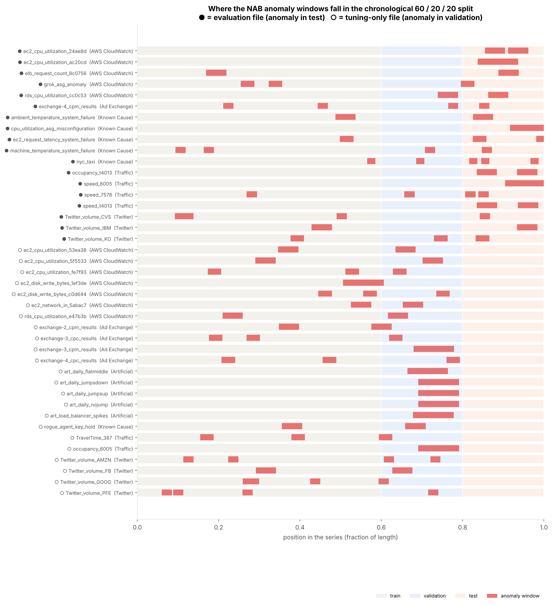
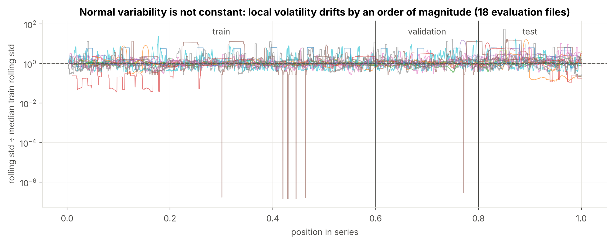

# Robust Adaptive Thresholding for LSTM Autoencoder-Based Anomaly Detection in Streaming Time Series

**Zain Hassan · MS Data Science · FAST-NUCES Islamabad · Reg. 26I-8015**

An LSTM Autoencoder turns each NAB time series into a stream of reconstruction errors. A *threshold rule* then decides which errors are anomalies. This project asks whether a **moving Median + λ·MAD threshold** (proposed) beats the usual fixed thresholds, in a controlled experiment where the data, split, model and errors are identical and **only the threshold rule changes**.

> 📊 **Interactive dashboard:** open [`dashboard/index.html`](dashboard/index.html) in a browser (needs internet for the Plotly library).
> 📄 **Protocol fixed before training:** [`PROTOCOL.md`](PROTOCOL.md) · **Results write-up:** [`docs/RESULTS.md`](docs/RESULTS.md)


## The idea in one picture


- A **fixed** threshold (orange-red) fires constantly once normal variability increases.
- **Rolling mean + 3σ** (base paper) jumps after one isolated spike.
- **Median + λ·MAD with plain memory** absorbs a long anomaly into its own window.
- **Gated memory** keeps anomalous errors out of the window, so the anomaly stays visible.

P1 chooses between plain and gated memory on validation data.

## Results

<!-- RESULTS_START -->
*Results appear here after the AWS training run (see `docs/AWS_RUNBOOK.md`).*
<!-- RESULTS_END -->

## Data



- **18 evaluation files** (5 NAB domains): every real NAB file with a labelled anomaly in its test part.
- **25 tuning files**: every real file with an anomaly in its validation part.
- Earlier versions used 46 files, and 28 of them had no anomaly in the test part. Those files can't measure detection.
- Per-file EDA figures are in [`figures/eda/series/`](figures/eda/series/). The summary table is [`results/eda_summary.csv`](results/eda_summary.csv).



## Methods compared

| ID | Threshold rule | Role |
|---|---|---|
| B1 | fixed p-th percentile of training errors | baseline (proposal) |
| B2 | fixed mean + k·σ of training errors | baseline (proposal) |
| B3 | rolling mean + 3σ of the last w errors | 2026 base paper |
| **P1** | **moving median + λ·MAD of the last w errors** | **proposed** |
| A1–A4 | {median/MAD, mean/σ} × {plain, gated memory} | ablation |

All parameters are chosen on **validation data only** (mean composite F1 over the 25 tuning files). Test labels are used only for the final scores.

## Metrics

| Metric | Meaning |
|---|---|
| Point precision / recall / F1, FPR | every time step inside a NAB window is a positive |
| Event recall | share of anomaly windows with at least one alarm |
| **Composite F1** | harmonic mean of point precision and event recall (Garg et al., 2021). NAB labels are windows, so each event counts once, and every false alarm still costs. |
| **NAB score** | official Numenta scoring, verified against `numenta/NAB/nab/sweeper.py` (max difference 4e-15 over 900 random cases). 0 = never alarming, 100 = perfect. Standard, reward-low-FP and reward-low-FN profiles. |
| High-variance FPR | false alarms on normal points during high local volatility (RQ3 / H2) |
| Detection delay | how far into the window the first alarm comes |
| ROC-AUC, PR-AUC | quality of the LSTM-AE score itself; identical for all threshold rules (RQ1) |

## Repository map

| Path | Content |
|---|---|
| `PROTOCOL.md` | every design decision, committed before training |
| `configs/` | experiment configuration and selected datasets |
| `src/atd/` | data, LSTM-AE, threshold rules, NAB scorer, metrics, statistics |
| `scripts/` | `select_datasets` → `train_score` → `evaluate` → `make_figures` / `make_eda` / `make_dashboard` |
| `results/` | every number: per-file, per-seed, tuning, statistics, hypotheses |
| `figures/` | all PNG figures (method, EDA, results, per-file threshold traces) |
| `dashboard/` | interactive HTML dashboard |
| `aws/`, `docs/AWS_RUNBOOK.md` | how the training was run on AWS EC2 |
| `tests/` | unit tests (`python tests/test_core.py`) |

## Reproduce

```bash
pip install -r requirements.txt
python scripts/select_datasets.py
python scripts/train_score.py --shard 0 --of 1     # 324 LSTM-AE fits (or run 4 shards on AWS)
python scripts/evaluate.py
python scripts/make_eda.py && python scripts/make_figures.py && python scripts/make_dashboard.py
```

Data: Numenta Anomaly Benchmark v1.1 (Lavin & Ahmad, 2015), included under `data/nab/` with its labels.
