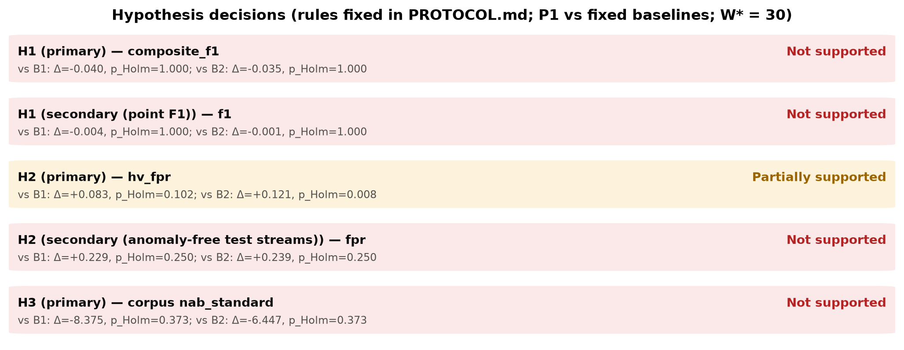
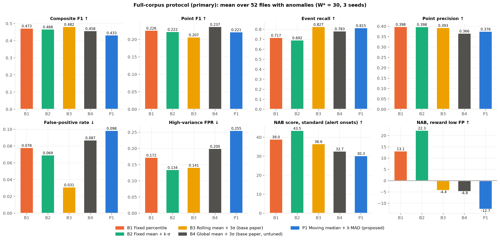
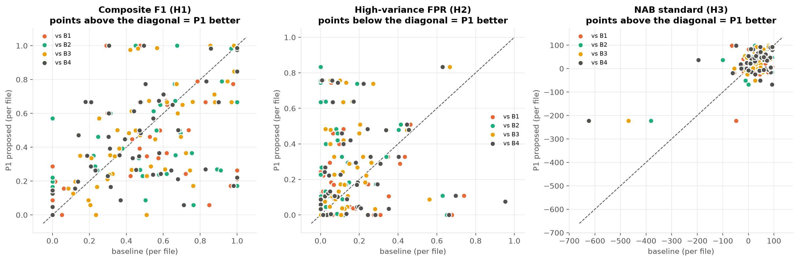
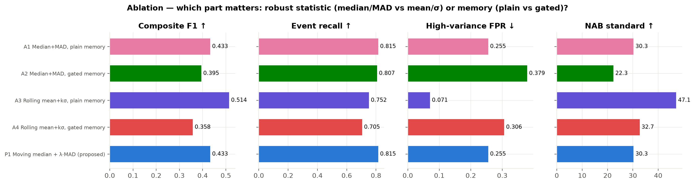
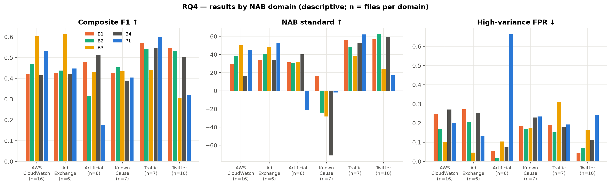
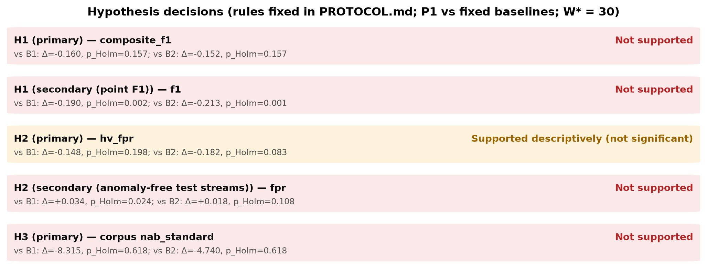
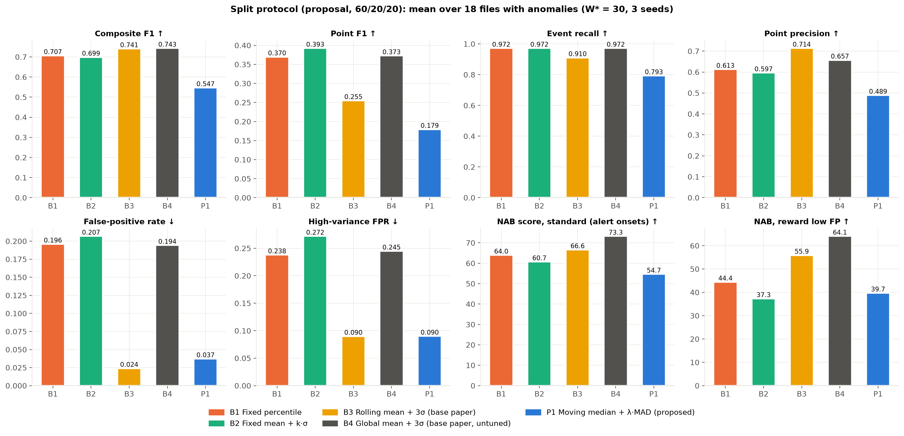
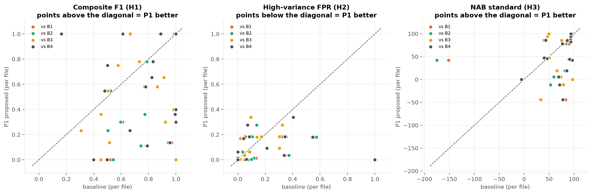
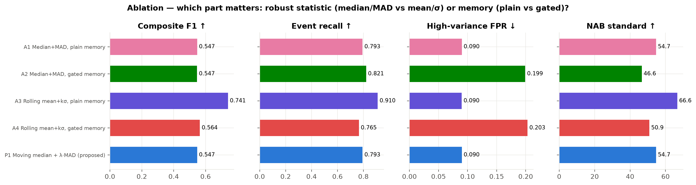
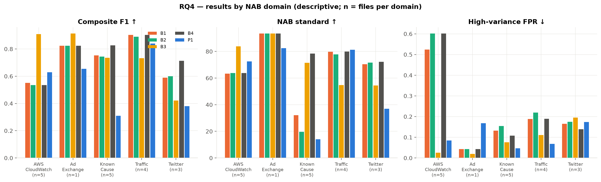

# Results

All numbers below are read from `results/` by `scripts/make_report.py`; all figures are generated by the pipeline. Decision rules were fixed in [PROTOCOL.md](../PROTOCOL.md) before training.

## Full-corpus protocol (primary)

58 NAB files. The LSTM-AE learned from normal windows in the first 15 % of each file (NAB probationary period); the remaining 85 % is scored: 52 files with 107 anomaly windows, plus 6 anomaly-free files where every alarm is false. Threshold parameters were chosen leave-one-file-out, so no file is scored with parameters fitted on its own labels. W* = 30 (selected in the split protocol).

### Hypothesis decisions

| Hypothesis | Metric | Verdict (rule in PROTOCOL.md) | P1 − baseline: mean Δ, p (Holm), files where P1 is better |
|---|---|---|---|
| H1 (primary) | composite_f1 | **Not supported** | B1: -0.040, p=1.000, 26/52; B2: -0.035, p=1.000, 27/52 |
| H1 (secondary (point F1)) | f1 | **Not supported** | B1: -0.004, p=1.000, 26/52; B2: -0.001, p=1.000, 25/52 |
| H2 (primary) | hv_fpr | **Partially supported** | B1: +0.083, p=0.102, 19/48; B2: +0.121, p=0.008, 14/48 |
| H2 (secondary (anomaly-free test streams)) | fpr | **Not supported** | B1: +0.229, p=0.250, 1/6; B2: +0.239, p=0.250, 0/6 |
| H3 (primary) | corpus nab_standard | **Not supported** | B1: -8.375, p=0.373, 22/52; B2: -6.447, p=0.373, 19/52 |

For FPR metrics a negative Δ favours P1; for all others a positive Δ does. The verdict applies the pre-registered rule; the last column shows direction and size.

### Main comparison

| Method | Composite F1 ↑ | Point F1 ↑ | Precision ↑ | Recall ↑ | Event recall ↑ | FPR ↓ | High-var FPR ↓ | Alerts ↓ | NAB std ↑ | NAB low-FP ↑ | NAB low-FN ↑ | Delay ↓ |
|---|---:|---:|---:|---:|---:|---:|---:|---:|---:|---:|---:|---:|
| B1 Fixed percentile | 0.473 | 0.226 | 0.398 | 0.231 | 0.717 | 0.078 | 0.172 | 11.6 | 39.0 | 13.1 | 48.9 | 0.397 |
| B2 Fixed mean + k·σ | 0.468 | 0.222 | 0.398 | 0.217 | 0.692 | 0.069 | 0.134 | 11.0 | 43.5 | 22.3 | 52.1 | 0.429 |
| B3 Rolling mean + 3σ (base paper) | 0.482 | 0.207 | 0.393 | 0.151 | 0.827 | 0.031 | 0.141 | 17.9 | 36.6 | -4.370 | 51.7 | 0.367 |
| B4 Global mean + 3σ (base paper, untuned) | 0.458 | 0.237 | 0.366 | 0.246 | 0.783 | 0.087 | 0.200 | 17.3 | 32.7 | -4.814 | 46.6 | 0.383 |
| **P1 Moving median + λ·MAD (proposed)** | 0.433 | 0.221 | 0.376 | 0.219 | 0.815 | 0.098 | 0.255 | 17.3 | 30.3 | -12.7 | 46.2 | 0.354 |

### Selected parameters (chosen without test labels)

| Method | Parameters |
|---|---|
| A1 Median+MAD, plain memory | `{"lam": 15, "w": 200}` (most frequent leave-one-out choice, 55 files) |
| A2 Median+MAD, gated memory | `{"lam": 15, "w": 200}` (most frequent leave-one-out choice, 54 files) |
| A3 Rolling mean+kσ, plain memory | `{"k": 4, "w": 400}` (most frequent leave-one-out choice, 58 files) |
| A4 Rolling mean+kσ, gated memory | `{"k": 6, "w": 200}` (most frequent leave-one-out choice, 45 files) |
| B1 Fixed percentile | `{"p": 99.5}` (most frequent leave-one-out choice, 57 files) |
| B2 Fixed mean + k·σ | `{"k": 4}` (most frequent leave-one-out choice, 56 files) |
| B3 Rolling mean + 3σ (base paper) | `{"k": 3, "w": 400}` (most frequent leave-one-out choice, 58 files) |
| B4 Global mean + 3σ (base paper, untuned) | `{"k": 3}` (most frequent leave-one-out choice, 58 files) |
| P1 Moving median + λ·MAD (proposed) | `{"lam": 15, "memory": "plain", "w": 200}` (most frequent leave-one-out choice, 55 files) |

### Statistical tests: P1 versus the baselines

Paired Wilcoxon signed-rank tests across files, Holm-adjusted within each metric; * = p < 0.05. Δ = P1 − other; for ↓ metrics a negative Δ favours P1.

| Metric | vs | n | P1 mean | other mean | Δ (95 % CI) | P1 better on | p (Holm) | effect r |
|---|---|---:|---:|---:|---|---:|---:|---:|
| composite_f1 | B1 | 52 | 0.433 | 0.473 | -0.040 (-0.133, 0.049) | 26/52 | 1.000 | -0.07 |
| composite_f1 | B2 | 52 | 0.433 | 0.468 | -0.035 (-0.119, 0.047) | 27/52 | 1.000 | -0.07 |
| composite_f1 | B3 | 52 | 0.433 | 0.482 | -0.049 (-0.118, 0.017) | 24/52 | 0.681 | -0.24 |
| composite_f1 | B4 | 52 | 0.433 | 0.458 | -0.025 (-0.105, 0.051) | 27/52 | 1.000 | -0.02 |
| f1 | B1 | 52 | 0.221 | 0.226 | -0.004 (-0.053, 0.041) | 26/52 | 1.000 | 0.08 |
| f1 | B2 | 52 | 0.221 | 0.222 | -0.001 (-0.050, 0.044) | 25/52 | 1.000 | 0.10 |
| f1 | B3 | 52 | 0.221 | 0.207 | +0.015 (-0.016, 0.046) | 25/52 | 1.000 | 0.11 |
| f1 | B4 | 52 | 0.221 | 0.237 | -0.015 (-0.061, 0.025) | 21/52 | 1.000 | -0.03 |
| event_recall | B1 | 52 | 0.815 | 0.717 | +0.097 (0.004, 0.197) | 14/52 | 0.336 | 0.46 |
| event_recall | B2 | 52 | 0.815 | 0.692 | +0.122 (0.020, 0.235) | 16/52 | 0.329 | 0.46 |
| event_recall | B3 | 52 | 0.815 | 0.827 | -0.012 (-0.099, 0.075) | 8/52 | 1.000 | -0.07 |
| event_recall | B4 | 52 | 0.815 | 0.783 | +0.032 (-0.047, 0.115) | 11/52 | 1.000 | 0.15 |
| fpr | B1 | 52 | 0.098 | 0.078 | +0.020 (-0.037, 0.075) | 19/52 | 0.298 | 0.26 |
| fpr | B2 | 52 | 0.098 | 0.069 | +0.029 (-0.028, 0.083) | 17/52 | 0.185 | 0.32 |
| fpr | B3 | 52 | 0.098 | 0.031 | +0.067 (0.036, 0.102) | 21/52 | 0.016* | 0.47 |
| fpr | B4 | 52 | 0.098 | 0.087 | +0.011 (-0.046, 0.066) | 22/52 | 0.687 | 0.15 |
| hv_fpr | B1 | 48 | 0.255 | 0.172 | +0.083 (-0.013, 0.182) | 19/48 | 0.307 | 0.27 |
| hv_fpr | B2 | 48 | 0.255 | 0.134 | +0.121 (0.030, 0.215) | 14/48 | 0.017* | 0.49 |
| hv_fpr | B3 | 48 | 0.255 | 0.141 | +0.114 (0.048, 0.186) | 18/48 | 0.012* | 0.49 |
| hv_fpr | B4 | 48 | 0.255 | 0.200 | +0.056 (-0.030, 0.145) | 20/48 | 0.307 | 0.25 |
| nab_standard | B1 | 52 | 29.0 | 37.3 | -8.375 (-23.6, 6.535) | 22/52 | 1.000 | -0.16 |
| nab_standard | B2 | 52 | 29.0 | 35.4 | -6.447 (-19.6, 7.246) | 19/52 | 1.000 | -0.21 |
| nab_standard | B3 | 52 | 29.0 | 30.5 | -1.581 (-16.3, 13.6) | 23/52 | 1.000 | -0.11 |
| nab_standard | B4 | 52 | 29.0 | 22.6 | +6.346 (-13.8, 30.3) | 27/52 | 1.000 | 0.01 |

### P1 versus the base-paper rules (rolling and global mean + 3σ)

| Metric | vs | n | P1 mean | other mean | Δ (95 % CI) | P1 better on | p (Holm) | effect r |
|---|---|---:|---:|---:|---|---:|---:|---:|
| composite_f1 | B3 | 52 | 0.433 | 0.482 | -0.049 (-0.118, 0.017) | 24/52 | 0.272 | -0.24 |
| composite_f1 | B4 | 52 | 0.433 | 0.458 | -0.025 (-0.105, 0.051) | 27/52 | 0.885 | -0.02 |
| f1 | B3 | 52 | 0.221 | 0.207 | +0.015 (-0.016, 0.046) | 25/52 | 0.952 | 0.11 |
| f1 | B4 | 52 | 0.221 | 0.237 | -0.015 (-0.061, 0.025) | 21/52 | 0.952 | -0.03 |
| precision | B3 | 52 | 0.376 | 0.393 | -0.018 (-0.096, 0.059) | 25/52 | 1.000 | -0.09 |
| precision | B4 | 52 | 0.376 | 0.366 | +0.009 (-0.084, 0.099) | 28/52 | 1.000 | 0.06 |
| event_recall | B3 | 52 | 0.815 | 0.827 | -0.012 (-0.099, 0.075) | 8/52 | 1.000 | -0.07 |
| event_recall | B4 | 52 | 0.815 | 0.783 | +0.032 (-0.047, 0.115) | 11/52 | 1.000 | 0.15 |
| fpr | B3 | 52 | 0.098 | 0.031 | +0.067 (0.036, 0.102) | 21/52 | 0.006* | 0.47 |
| fpr | B4 | 52 | 0.098 | 0.087 | +0.011 (-0.046, 0.066) | 22/52 | 0.344 | 0.15 |
| hv_fpr | B3 | 48 | 0.255 | 0.141 | +0.114 (0.048, 0.186) | 18/48 | 0.005* | 0.49 |
| hv_fpr | B4 | 48 | 0.255 | 0.200 | +0.056 (-0.030, 0.145) | 20/48 | 0.131 | 0.25 |
| nab_standard | B3 | 52 | 29.0 | 30.5 | -1.581 (-16.3, 13.6) | 23/52 | 1.000 | -0.11 |
| nab_standard | B4 | 52 | 29.0 | 22.6 | +6.346 (-13.8, 30.3) | 27/52 | 1.000 | 0.01 |

### Ablation: statistic × memory

| Method | Composite F1 ↑ | Point F1 ↑ | Precision ↑ | Recall ↑ | Event recall ↑ | FPR ↓ | High-var FPR ↓ | Alerts ↓ | NAB std ↑ | NAB low-FP ↑ | NAB low-FN ↑ | Delay ↓ |
|---|---:|---:|---:|---:|---:|---:|---:|---:|---:|---:|---:|---:|
| **P1 Moving median + λ·MAD (proposed)** | 0.433 | 0.221 | 0.376 | 0.219 | 0.815 | 0.098 | 0.255 | 17.3 | 30.3 | -12.7 | 46.2 | 0.354 |
| A1 Median+MAD, plain memory | 0.433 | 0.221 | 0.376 | 0.219 | 0.815 | 0.098 | 0.255 | 17.3 | 30.3 | -12.7 | 46.2 | 0.354 |
| A2 Median+MAD, gated memory | 0.395 | 0.239 | 0.319 | 0.323 | 0.807 | 0.166 | 0.379 | 19.9 | 22.3 | -25.4 | 39.7 | 0.320 |
| A3 Rolling mean+kσ, plain memory | 0.514 | 0.152 | 0.462 | 0.098 | 0.752 | 0.015 | 0.071 | 11.4 | 47.1 | 23.5 | 56.6 | 0.415 |
| A4 Rolling mean+kσ, gated memory | 0.358 | 0.226 | 0.272 | 0.258 | 0.705 | 0.100 | 0.306 | 16.1 | 32.7 | -2.974 | 45.9 | 0.355 |

### By domain (RQ4)

| Domain | n | B1 comp.F1 | B2 comp.F1 | B3 comp.F1 | B4 comp.F1 | P1 comp.F1 | B1 NAB | B2 NAB | B3 NAB | B4 NAB | P1 NAB |
|---|---:|---:|---:|---:|---:|---:|---:|---:|---:|---:|---:|
| AWS CloudWatch | 16 | 0.420 | 0.468 | 0.602 | 0.415 | 0.532 | 29.7 | 38.6 | 50.0 | 16.6 | 45.2 |
| Ad Exchange | 6 | 0.426 | 0.438 | 0.612 | 0.422 | 0.447 | 33.8 | 40.7 | 48.6 | 34.2 | 53.1 |
| Artificial | 6 | 0.479 | 0.315 | 0.430 | 0.512 | 0.177 | 31.4 | 30.5 | 32.1 | 40.1 | -21.2 |
| Known Cause | 7 | 0.427 | 0.453 | 0.433 | 0.389 | 0.404 | 16.6 | -24.1 | -28.4 | -71.2 | -1.880 |
| Traffic | 7 | 0.572 | 0.543 | 0.441 | 0.545 | 0.600 | 56.1 | 48.5 | 37.9 | 52.9 | 62.0 |
| Twitter | 10 | 0.546 | 0.534 | 0.306 | 0.502 | 0.322 | 56.5 | 62.6 | 23.8 | 59.3 | 17.0 |

### Other figures

- [Precision, recall and F1](../figures/full/precision_recall_f1.png)
- [Confusion matrices](../figures/full/confusion_matrices.png)
- [Signal, reconstruction, score and thresholds on one file](../figures/full/walkthrough_signal_score_threshold.png)
- [Training vs hold-out loss](../figures/full/loss_curves_examples.png)
- [Composite F1 per file and method](../figures/full/heatmap_composite_f1.png)
- [NAB score per file](../figures/full/heatmap_nab_standard.png)
- [High-variance FPR per file](../figures/full/heatmap_hv_fpr.png)
- [Each rule's operating point on the model's ROC curve](../figures/full/roc_operating_points.png)
- [Reconstruction-error distributions, normal vs anomalous](../figures/full/error_distributions.png)
- [MAD vs std scale of training errors](../figures/full/scale_diagnostic.png)
- [TP / FP / FN shares](../figures/full/alarm_outcomes.png)
- [Overall profile](../figures/full/radar_profile.png)
- [Average rank](../figures/full/average_rank.png)
- [Detection delay and alert counts](../figures/full/delay_and_alerts.png)
- [False alarms on anomaly-free streams](../figures/full/clean_stream_false_alarms.png)
- [λ sensitivity](../figures/full/sensitivity_lambda_validation.png)
- [LSTM-AE training curves](../figures/full/training_curves.png)
- [Model ROC/PR-AUC per file](../figures/full/model_quality_auc.png)
- Per-file threshold traces: `../figures/full/traces/` · vector PDFs for the paper: `../figures/full/pdf/`

## Split protocol (proposal, 60/20/20)

Chronological 60/20/20 split per file. 18 files have a labelled anomaly in their test partition (25 anomaly windows); thresholds were tuned on the validation partitions of 30 files. Window size W* = 30 (highest validation ROC-AUC). Metrics are seed-averaged per file, then averaged over files; NAB scores are corpus-level.

### Hypothesis decisions

| Hypothesis | Metric | Verdict (rule in PROTOCOL.md) | P1 − baseline: mean Δ, p (Holm), files where P1 is better |
|---|---|---|---|
| H1 (primary) | composite_f1 | **Not supported** | B1: -0.160, p=0.157, 5/18; B2: -0.152, p=0.157, 5/18 |
| H1 (secondary (point F1)) | f1 | **Not supported** | B1: -0.190, p=0.002, 3/18; B2: -0.213, p=0.001, 3/18 |
| H2 (primary) | hv_fpr | **Supported descriptively (not significant)** | B1: -0.148, p=0.198, 9/17; B2: -0.182, p=0.083, 10/17 |
| H2 (secondary (anomaly-free test streams)) | fpr | **Not supported** | B1: +0.034, p=0.024, 4/23; B2: +0.018, p=0.108, 7/23 |
| H3 (primary) | corpus nab_standard | **Not supported** | B1: -8.315, p=0.618, 8/18; B2: -4.740, p=0.618, 9/18 |

For FPR metrics a negative Δ favours P1; for all others a positive Δ does. The verdict applies the pre-registered rule; the last column shows direction and size.

### Main comparison

| Method | Composite F1 ↑ | Point F1 ↑ | Precision ↑ | Recall ↑ | Event recall ↑ | FPR ↓ | High-var FPR ↓ | Alerts ↓ | NAB std ↑ | NAB low-FP ↑ | NAB low-FN ↑ | Delay ↓ |
|---|---:|---:|---:|---:|---:|---:|---:|---:|---:|---:|---:|---:|
| B1 Fixed percentile | 0.707 | 0.370 | 0.613 | 0.370 | 0.972 | 0.196 | 0.238 | 9.056 | 64.0 | 44.4 | 72.0 | 0.366 |
| B2 Fixed mean + k·σ | 0.699 | 0.393 | 0.597 | 0.397 | 0.972 | 0.207 | 0.272 | 9.907 | 60.7 | 37.3 | 69.8 | 0.328 |
| B3 Rolling mean + 3σ (base paper) | 0.741 | 0.255 | 0.714 | 0.169 | 0.910 | 0.024 | 0.090 | 4.741 | 66.6 | 55.9 | 72.0 | 0.396 |
| B4 Global mean + 3σ (base paper, untuned) | 0.743 | 0.373 | 0.657 | 0.373 | 0.972 | 0.194 | 0.245 | 5.611 | 73.3 | 64.1 | 78.2 | 0.380 |
| **P1 Moving median + λ·MAD (proposed)** | 0.547 | 0.179 | 0.489 | 0.138 | 0.793 | 0.037 | 0.090 | 5.759 | 54.7 | 39.7 | 61.8 | 0.399 |

### Selected parameters (chosen without test labels)

| Method | Parameters |
|---|---|
| A1 Median+MAD, plain memory | `{"lam": 15, "w": 50}` |
| A2 Median+MAD, gated memory | `{"lam": 15, "w": 50}` |
| A3 Rolling mean+kσ, plain memory | `{"k": 3, "w": 400}` |
| A4 Rolling mean+kσ, gated memory | `{"k": 6, "w": 100}` |
| B1 Fixed percentile | `{"p": 98}` |
| B2 Fixed mean + k·σ | `{"k": 2.5}` |
| B3 Rolling mean + 3σ (base paper) | `{"k": 3, "w": 400}` |
| B4 Global mean + 3σ (base paper, untuned) | `{"k": 3}` |
| P1 Moving median + λ·MAD (proposed) | `{"lam": 15, "memory": "plain", "w": 50}` |

### Statistical tests: P1 versus the baselines

Paired Wilcoxon signed-rank tests across files, Holm-adjusted within each metric; * = p < 0.05. Δ = P1 − other; for ↓ metrics a negative Δ favours P1.

| Metric | vs | n | P1 mean | other mean | Δ (95 % CI) | P1 better on | p (Holm) | effect r |
|---|---|---:|---:|---:|---|---:|---:|---:|
| composite_f1 | B1 | 18 | 0.547 | 0.707 | -0.160 (-0.334, 0.027) | 5/18 | 0.472 | -0.50 |
| composite_f1 | B2 | 18 | 0.547 | 0.699 | -0.152 (-0.327, 0.035) | 5/18 | 0.472 | -0.47 |
| composite_f1 | B3 | 18 | 0.547 | 0.741 | -0.194 (-0.361, -0.036) | 6/18 | 0.445 | -0.54 |
| composite_f1 | B4 | 18 | 0.547 | 0.743 | -0.196 (-0.386, 0.001) | 5/18 | 0.472 | -0.50 |
| f1 | B1 | 18 | 0.179 | 0.370 | -0.190 (-0.302, -0.090) | 3/18 | 0.012* | -0.78 |
| f1 | B2 | 18 | 0.179 | 0.393 | -0.213 (-0.319, -0.117) | 3/18 | 0.004* | -0.86 |
| f1 | B3 | 18 | 0.179 | 0.255 | -0.076 (-0.125, -0.022) | 4/18 | 0.042* | -0.65 |
| f1 | B4 | 18 | 0.179 | 0.373 | -0.193 (-0.298, -0.098) | 3/18 | 0.008* | -0.81 |
| event_recall | B1 | 18 | 0.793 | 0.972 | -0.179 (-0.370, 0.000) | 1/18 | 0.734 | -0.76 |
| event_recall | B2 | 18 | 0.793 | 0.972 | -0.179 (-0.370, 0.000) | 1/18 | 0.734 | -0.76 |
| event_recall | B3 | 18 | 0.793 | 0.910 | -0.117 (-0.324, 0.074) | 3/18 | 1.000 | -0.42 |
| event_recall | B4 | 18 | 0.793 | 0.972 | -0.179 (-0.370, 0.000) | 1/18 | 0.734 | -0.76 |
| fpr | B1 | 18 | 0.037 | 0.196 | -0.159 (-0.328, -0.021) | 10/18 | 0.668 | -0.43 |
| fpr | B2 | 18 | 0.037 | 0.207 | -0.170 (-0.337, -0.034) | 11/18 | 0.296 | -0.56 |
| fpr | B3 | 18 | 0.037 | 0.024 | +0.013 (-0.003, 0.032) | 4/18 | 0.668 | 0.45 |
| fpr | B4 | 18 | 0.037 | 0.194 | -0.157 (-0.326, -0.020) | 10/18 | 0.668 | -0.41 |
| hv_fpr | B1 | 17 | 0.090 | 0.238 | -0.148 (-0.325, -0.002) | 9/17 | 0.792 | -0.39 |
| hv_fpr | B2 | 17 | 0.090 | 0.272 | -0.182 (-0.350, -0.042) | 10/17 | 0.248 | -0.62 |
| hv_fpr | B3 | 17 | 0.090 | 0.090 | +0.000 (-0.042, 0.045) | 7/17 | 1.000 | -0.15 |
| hv_fpr | B4 | 17 | 0.090 | 0.245 | -0.155 (-0.328, -0.013) | 9/17 | 0.700 | -0.45 |
| nab_standard | B1 | 18 | 52.8 | 61.2 | -8.315 (-35.2, 22.9) | 8/18 | 1.000 | -0.28 |
| nab_standard | B2 | 18 | 52.8 | 57.6 | -4.740 (-31.6, 28.9) | 9/18 | 1.000 | -0.23 |
| nab_standard | B3 | 18 | 52.8 | 69.6 | -16.725 (-37.2, 2.406) | 5/18 | 0.717 | -0.45 |
| nab_standard | B4 | 18 | 52.8 | 74.5 | -21.625 (-40.1, -4.729) | 8/18 | 0.717 | -0.42 |

### P1 versus the base-paper rules (rolling and global mean + 3σ)

| Metric | vs | n | P1 mean | other mean | Δ (95 % CI) | P1 better on | p (Holm) | effect r |
|---|---|---:|---:|---:|---|---:|---:|---:|
| composite_f1 | B3 | 18 | 0.547 | 0.741 | -0.194 (-0.361, -0.036) | 6/18 | 0.111 | -0.54 |
| composite_f1 | B4 | 18 | 0.547 | 0.743 | -0.196 (-0.386, 0.001) | 5/18 | 0.111 | -0.50 |
| f1 | B3 | 18 | 0.179 | 0.255 | -0.076 (-0.125, -0.022) | 4/18 | 0.014* | -0.65 |
| f1 | B4 | 18 | 0.179 | 0.373 | -0.193 (-0.298, -0.098) | 3/18 | 0.003* | -0.81 |
| precision | B3 | 18 | 0.489 | 0.714 | -0.225 (-0.377, -0.094) | 3/18 | 0.009* | -0.87 |
| precision | B4 | 18 | 0.489 | 0.657 | -0.168 (-0.374, 0.041) | 6/18 | 0.134 | -0.43 |
| event_recall | B3 | 18 | 0.793 | 0.910 | -0.117 (-0.324, 0.074) | 3/18 | 0.287 | -0.42 |
| event_recall | B4 | 18 | 0.793 | 0.972 | -0.179 (-0.370, 0.000) | 1/18 | 0.183 | -0.76 |
| fpr | B3 | 18 | 0.037 | 0.024 | +0.013 (-0.003, 0.032) | 4/18 | 0.295 | 0.45 |
| fpr | B4 | 18 | 0.037 | 0.194 | -0.157 (-0.326, -0.020) | 10/18 | 0.295 | -0.41 |
| hv_fpr | B3 | 17 | 0.090 | 0.090 | +0.000 (-0.042, 0.045) | 7/17 | 0.638 | -0.15 |
| hv_fpr | B4 | 17 | 0.090 | 0.245 | -0.155 (-0.328, -0.013) | 9/17 | 0.280 | -0.45 |
| nab_standard | B3 | 18 | 52.8 | 69.6 | -16.725 (-37.2, 2.406) | 5/18 | 0.205 | -0.45 |
| nab_standard | B4 | 18 | 52.8 | 74.5 | -21.625 (-40.1, -4.729) | 8/18 | 0.205 | -0.42 |

### Ablation: statistic × memory

| Method | Composite F1 ↑ | Point F1 ↑ | Precision ↑ | Recall ↑ | Event recall ↑ | FPR ↓ | High-var FPR ↓ | Alerts ↓ | NAB std ↑ | NAB low-FP ↑ | NAB low-FN ↑ | Delay ↓ |
|---|---:|---:|---:|---:|---:|---:|---:|---:|---:|---:|---:|---:|
| **P1 Moving median + λ·MAD (proposed)** | 0.547 | 0.179 | 0.489 | 0.138 | 0.793 | 0.037 | 0.090 | 5.759 | 54.7 | 39.7 | 61.8 | 0.399 |
| A1 Median+MAD, plain memory | 0.547 | 0.179 | 0.489 | 0.138 | 0.793 | 0.037 | 0.090 | 5.759 | 54.7 | 39.7 | 61.8 | 0.399 |
| A2 Median+MAD, gated memory | 0.547 | 0.293 | 0.482 | 0.267 | 0.821 | 0.082 | 0.199 | 7.074 | 46.6 | 27.3 | 55.1 | 0.390 |
| A3 Rolling mean+kσ, plain memory | 0.741 | 0.255 | 0.714 | 0.169 | 0.910 | 0.024 | 0.090 | 4.741 | 66.6 | 55.9 | 72.0 | 0.396 |
| A4 Rolling mean+kσ, gated memory | 0.564 | 0.298 | 0.501 | 0.279 | 0.765 | 0.077 | 0.203 | 4.852 | 50.9 | 38.7 | 56.6 | 0.393 |

### By domain (RQ4)

| Domain | n | B1 comp.F1 | B2 comp.F1 | B3 comp.F1 | B4 comp.F1 | P1 comp.F1 | B1 NAB | B2 NAB | B3 NAB | B4 NAB | P1 NAB |
|---|---:|---:|---:|---:|---:|---:|---:|---:|---:|---:|---:|
| AWS CloudWatch | 5 | 0.551 | 0.535 | 0.909 | 0.535 | 0.630 | 63.2 | 63.8 | 83.9 | 63.8 | 72.5 |
| Ad Exchange | 1 | 0.824 | 0.824 | 0.913 | 0.824 | 0.653 | 93.4 | 93.4 | 93.4 | 93.4 | 82.4 |
| Known Cause | 5 | 0.753 | 0.744 | 0.735 | 0.826 | 0.309 | 32.2 | 19.6 | 71.4 | 78.3 | 14.1 |
| Traffic | 4 | 0.903 | 0.889 | 0.732 | 0.903 | 0.840 | 79.8 | 77.8 | 54.7 | 79.9 | 81.3 |
| Twitter | 3 | 0.589 | 0.600 | 0.422 | 0.713 | 0.380 | 70.4 | 71.6 | 54.4 | 72.3 | 36.9 |

### Other figures

- [Precision, recall and F1](../figures/split/precision_recall_f1.png)
- [Confusion matrices](../figures/split/confusion_matrices.png)
- [Signal, reconstruction, score and thresholds on one file](../figures/split/walkthrough_signal_score_threshold.png)
- [Training vs hold-out loss](../figures/split/loss_curves_examples.png)
- [Composite F1 per file and method](../figures/split/heatmap_composite_f1.png)
- [NAB score per file](../figures/split/heatmap_nab_standard.png)
- [High-variance FPR per file](../figures/split/heatmap_hv_fpr.png)
- [Each rule's operating point on the model's ROC curve](../figures/split/roc_operating_points.png)
- [Reconstruction-error distributions, normal vs anomalous](../figures/split/error_distributions.png)
- [MAD vs std scale of training errors](../figures/split/scale_diagnostic.png)
- [TP / FP / FN shares](../figures/split/alarm_outcomes.png)
- [Overall profile](../figures/split/radar_profile.png)
- [Average rank](../figures/split/average_rank.png)
- [Detection delay and alert counts](../figures/split/delay_and_alerts.png)
- [False alarms on anomaly-free streams](../figures/split/clean_stream_false_alarms.png)
- [λ sensitivity](../figures/split/sensitivity_lambda_validation.png)
- [Window-size effect](../figures/split/window_size_effect.png)
- [LSTM-AE training curves](../figures/split/training_curves.png)
- [Model ROC/PR-AUC per file](../figures/split/model_quality_auc.png)
- Per-file threshold traces: `../figures/split/traces/` · vector PDFs for the paper: `../figures/split/pdf/`

## Data and model

- [Corpus overview](../figures/eda/corpus_overview.png) · [split overview](../figures/eda/split_overview.png) · [preprocessing example](../figures/eda/preprocessing_example.png) · [variability drift](../figures/eda/variability_drift.png) · [anomaly window statistics](../figures/eda/anomaly_windows_stats.png) · [autocorrelation](../figures/eda/autocorrelation_by_domain.png) · per-file EDA in `figures/eda/series/`
